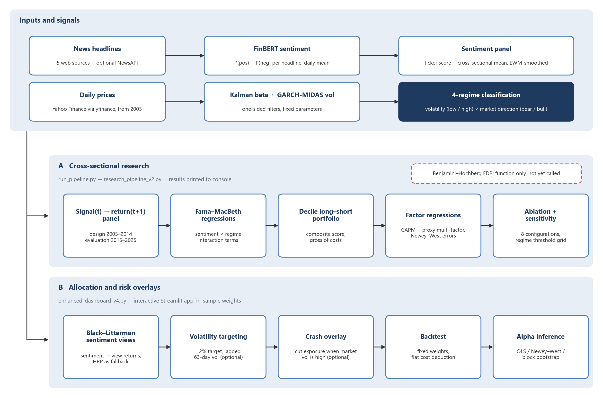
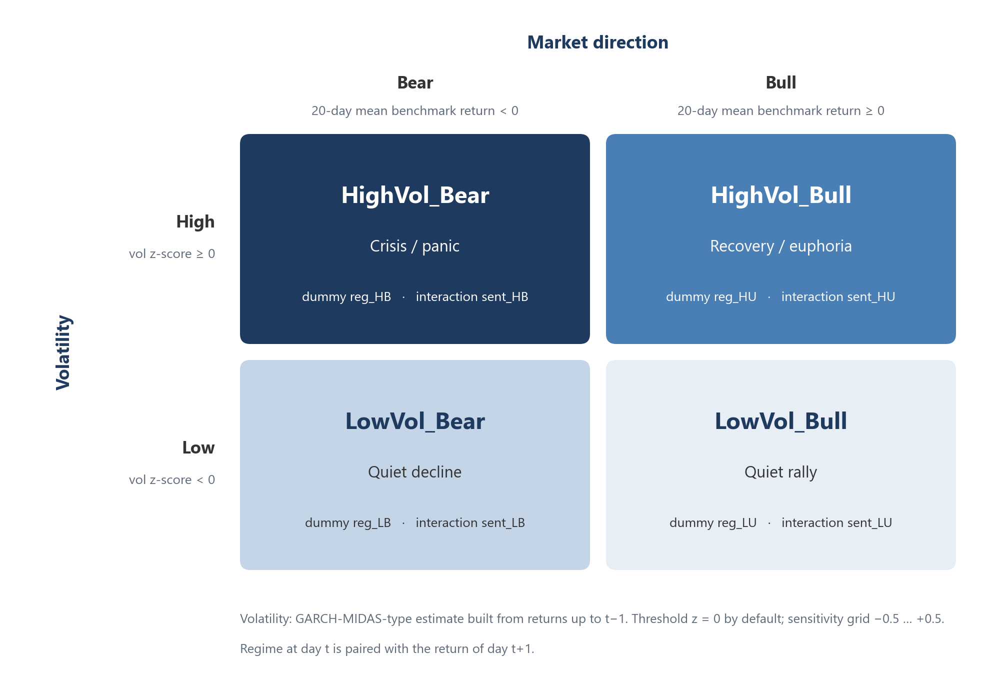
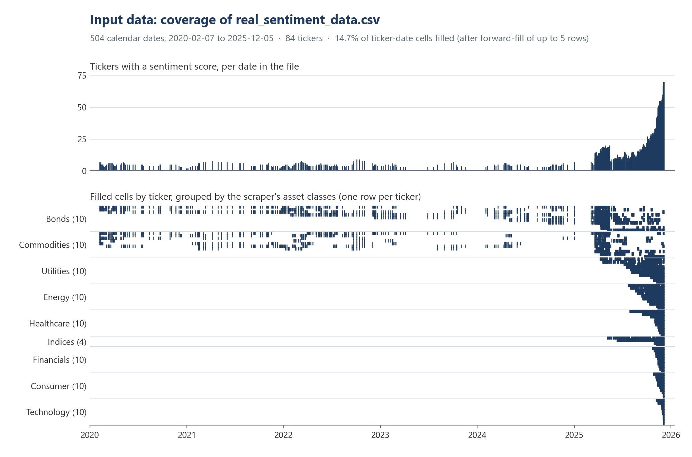

# Sentiment-Regime Portfolio

News-sentiment signals conditioned on a four-state regime (volatility × market direction), examined with a cross-sectional research pipeline and a Black–Litterman allocation dashboard.



## 개요

뉴스 헤드라인의 감성 점수가 다음 날 종목 수익률을 설명하는 정도가 시장 국면에 따라 달라지는지를 묻는 연구용 코드입니다. 국면은 변동성(낮음/높음)과 시장 방향(하락/상승)을 교차한 네 가지로 나누고, 감성 신호를 국면별 교차항으로 넣어 Fama–MacBeth 회귀와 분위 포트폴리오로 검정합니다. 같은 감성 점수를 Black–Litterman 모형의 전망(view)으로 바꿔 자산 비중을 구하는 대시보드도 함께 들어 있습니다.

이 저장소에는 방법과 검증 절차의 구현만 있고 성과 수치는 싣지 않았습니다. 실행 결과 파일이 커밋되어 있지 않고, 「한계와 다음 단계」에 적은 대로 감성 데이터의 기간이 짧아 결론을 낼 단계가 아니기 때문입니다.

- 대상: 미국 대형주 69종목과 지수 ETF 4종(SPY, QQQ, IWM, DIA)의 일별 자료, 2005년 이후
- 구성: 연구 파이프라인(`run_pipeline.py`)과 Streamlit 대시보드(`enhanced_dashboard_v4.py`)

## 방법론

### 1. 신호 계층

| 계층 | 구현 | 비고 |
|---|---|---|
| 동적 베타 | 종목별 Kalman filter (`β_t = β_{t-1} + w_t`) | 잡음 분산은 고정값 |
| 감성 | FinBERT(`ProsusAI/finbert`) 헤드라인 점수 `P(pos) − P(neg)` → 종목·일자 평균 → 당일 전체 평균을 뺀 상대 감성 → 지수가중 평활(decay 0.9) | `MARKET_SENTIMENT` 열은 당일 전체 평균 |
| 변동성 | 22일 가중 실현분산(장기 성분)과 GARCH(1,1) 재귀(단기 성분)를 결합한 GARCH-MIDAS 형태의 필터 | 모수는 추정하지 않고 고정값(α=0.1, β=0.85) |

### 2. 4-국면 분류



- 변동성 축: 변동성 추정치의 z-score가 임계값(기본 0) 미만이면 Low, 이상이면 High입니다. 연구 파이프라인은 날짜별 종목 횡단면에서 z-score를 구하므로 국면이 종목·일자 단위로 정해집니다.
- 방향 축: 벤치마크(SPY) 일수익률의 20일 이동평균이 0 이상이면 Bull, 미만이면 Bear입니다.
- 코드 라벨은 `LowVol_Bear`, `LowVol_Bull`, `HighVol_Bear`, `HighVol_Bull`이고, 회귀에는 표준화한 감성과 국면 더미의 곱(`sent_LB`, `sent_LU`, `sent_HB`, `sent_HU`)이 들어갑니다.

미래 정보 차단: 변동성은 t−1일까지의 수익률로, 베타·시장 방향·감성은 t일까지의 자료로 계산하고 모든 신호를 t+1일 수익률과 짝짓습니다. Kalman filter와 지수가중 평활은 과거에서 현재 방향으로만 갱신합니다. 이 원칙이 지켜지지 않는 부분은 「한계와 다음 단계」에 적었습니다.

### 3. 연구 파이프라인 (`run_pipeline.py`)

가격 파일이 없으면 `fetch_real_data.py`로 내려받고, 감성 파일이 없으면 스크레이퍼를 돌린 뒤 `research_pipeline_v2.py`를 실행합니다. 결과는 콘솔에 출력되고 파일로 저장되지 않습니다.

1. 종목·일자 패널 구성(전체, 설계, 평가 구간)
2. Fama–MacBeth 회귀: `ret(t+1) ~ beta + vol + sent_LB + sent_LU + sent_HB + sent_HU`
3. 합성 점수(베타·감성·변동성 z-score의 평균) 기준 10분위 long–short, 매일 재구성
4. long–short 수익률의 요인 회귀(CAPM, 다요인)
5. 8개 구성 ablation
6. 국면별 long–short 성과와 변동성 임계값 민감도(−0.5 ~ +0.5)
7. 비교 전략: 전일 감성 정렬, 비정상 부정 감성(60일 평균 대비), 12-1 모멘텀, 위험 변수만 쓴 정렬

### 4. 배분과 위험 관리 (대시보드)

- **Black–Litterman**: 균형수익률 `Π = λΣw`에서 출발합니다(시가총액 비중 대신 동일가중 사용). 감성 절댓값이 0.05를 넘는 종목마다 `Q_i = Π_i(1 + 0.15·s_i)` 형태의 절대 전망을 만들고, 전망 불확실성 Ω는 감성이 강할수록 작게 둡니다. 사후 기대수익률로 종목당 상한 20%의 long-only 최대 Sharpe 비중을 구합니다.
- **HRP**: Black–Litterman 계산이 실패하면 계층적 위험 균형(상관계수 거리 → 계층 군집 → 재귀 이분) 비중에 감성 기울기(±20%)를 곱해 대체합니다. `topology_allocation.py`에는 HERC와 MST 기반 배분도 있습니다.
- **변동성 관리**: 직전 63일 실현 변동성(1일 지연)으로 목표 변동성 12%에 맞춰 노출을 조절하고 레버리지는 2배로 제한합니다.
- **Crash overlay**: 시장의 22일 변동성이 상위 분위(기본 80%) 이상이면 다음 날 노출을 줄입니다.

변동성 관리와 crash overlay는 대시보드 옵션이며 기본값은 꺼짐입니다.

## 검증 설계

| 항목 | 구현 내용 |
|---|---|
| 표본 분할 | 설계 구간 2005-11-22 ~ 2014-12-31, 평가 구간 2015-01-01 ~ 2025-12-03. 모형 모수가 고정값이라 설계 구간에서 추정하는 값은 없습니다. Fama–MacBeth는 두 구간에 각각, 분위 포트폴리오·ablation·국면 분석은 평가 구간에만 실행합니다. |
| 거래비용 | 대시보드 백테스트는 월 8bp를 일할(8bp/21)로 일괄 차감합니다. 민감도 분석은 0~50bp 구간에서 월 회전율 30%를 가정합니다. 파이프라인의 long–short 수익률은 비용 차감 전입니다. |
| 요인 회귀 | 파이프라인: CAPM과 다요인 회귀, Newey–West(5 lags). 대시보드: OLS, Newey–West(12 lags), 잔차 circular block bootstrap(1,000회, 블록 21일) 중 선택. |
| 요인 자료 | Fama–French 5요인 + 모멘텀 CSV를 `factor_file`로 주면 그대로 씁니다. 기본 실행에는 요인 파일이 없어 표본 종목으로 만든 대용 요인(시장, 고변동−저변동, 저베타−고베타, 모멘텀)으로 회귀하며 RMW·CMA는 들어가지 않습니다. |
| 다중검정 보정 | Benjamini–Hochberg FDR 함수(`MultipleTestingAdjustment.benjamini_hochberg`, 기본 α=0.10)를 구현해 두었으나 현재 파이프라인과 대시보드에서 호출하지 않습니다. 대시보드의 보정 p값은 `1 − (1 − p)^N` 방식입니다. |
| Ablation | 베타·감성·변동성의 포함 여부 조합 8가지. 구성마다 합성 점수로 10분위 long–short을 만들어 CAPM alpha(HAC)와 Sharpe를 비교합니다. 신호를 모두 뺀 기준 구성은 값이 비어 있습니다. |
| 강건성 | 블록 부트스트랩(블록 22일)으로 구한 alpha·Sharpe 신뢰구간, 4개 하위 기간 분석, 국면 임계값 민감도. |

검증 항목은 외부 피드백을 반영해 강화한 것입니다.

## 저장소 구조

| 파일 | 역할 |
|---|---|
| `run_pipeline.py` | 데이터 확인 → 연구 파이프라인 실행 |
| `research_pipeline_v2.py` | 패널 구성, Fama–MacBeth, 분위 포트폴리오, 요인 회귀, ablation, 국면 민감도, BH 함수 |
| `enhanced_integrated_model_v3.py` | Kalman 베타, 감성 평활, 변동성 필터, 국면 분류, 통계 검증, 변동성 관리·crash overlay |
| `sentiment_bl_manager.py` | 감성 전망을 쓰는 Black–Litterman, 감성 캐시 관리 |
| `topology_allocation.py` | HRP, HERC, MST 기반 배분 |
| `multi_source_news_scraper.py` | 뉴스 헤드라인 수집, FinBERT 점수화, 일별 집계 |
| `fetch_real_data.py` | Yahoo Finance 가격 다운로드 |
| `enhanced_dashboard_v4.py` | Streamlit 대시보드 |
| `test_yf.py` | yfinance 연결 확인용 스크립트 |
| `real_sentiment_data.csv` | 감성 입력 데이터(아래 「데이터」 참고) |
| `assets/` | README 그림 |

## 실행 방법

```bash
pip install pandas numpy scipy statsmodels yfinance requests beautifulsoup4 transformers torch streamlit plotly

# 선택: NewsAPI를 뉴스 소스에 추가할 때만 필요
export NEWSAPI_KEY="<your-key>"          # PowerShell: $env:NEWSAPI_KEY="<your-key>"

python run_pipeline.py                   # 가격 다운로드 → 연구 파이프라인
streamlit run enhanced_dashboard_v4.py   # 대시보드
```

- 가격 패널(`real_backtest_panel.csv`)은 저장소에 없고 첫 실행 때 내려받습니다.
- 감성 파일이 이미 있으므로 `run_pipeline.py`는 뉴스 수집을 건너뜁니다. 새로 수집하려면 `python multi_source_news_scraper.py`를 실행하며, 이때 기존 파일을 덮어씁니다.
- NewsAPI 키는 환경변수 `NEWSAPI_KEY`로만 읽습니다. 값이 없으면 NewsAPI만 빼고 나머지 소스로 진행합니다.
- `requirements.txt`는 없고 패키지 버전을 고정하지 않았습니다. `networkx`는 MST 기반 배분에만 필요합니다.

## 데이터



*입력 데이터의 수록 범위를 보여 주는 그림이며 분석 결과가 아닙니다.*

- **감성** (`real_sentiment_data.csv`): 일자 × 종목 감성 표입니다. 504개 날짜(2020-02-07 ~ 2025-12-05, 주말 58일 포함), 84개 종목과 `MARKET_SENTIMENT` 열로 되어 있고 종목 칸의 14.7%에만 값이 있습니다(최대 5행 forward-fill 이후).
- 수집 시점에 각 사이트가 보여 주던 헤드라인을 한 번 모은 스냅샷입니다. 날짜 240개가 2025년에 몰려 있고, 2024년 이전에는 하루 4~5개 종목에만 값이 있으며 그 종목은 모두 채권·원자재 ETF입니다.
- 파일 구조(불규칙한 날짜, 주말 포함, 종목별로 크게 다른 수록 기간, 연속값 점수)는 `multi_source_news_scraper.py`의 출력과 일치합니다. 원본 헤드라인은 재배포하지 않으므로 이 파일을 저장소만으로 다시 만들 수는 없고, 다시 수집하면 내용이 달라집니다.
- 초기 커밋에는 임의 감성 생성 스크립트와 그 출력이 있었고 v5에서 삭제했습니다. 현재 파이프라인과 대시보드에는 난수로 감성을 만드는 경로가 없습니다. 모의 데이터를 쓰는 곳은 `sentiment_bl_manager.py`와 `topology_allocation.py`를 단독 실행할 때 도는 자체 점검 코드뿐입니다. 대체 경로는 두 가지입니다. `transformers`를 불러오지 못하면 FinBERT 대신 키워드 규칙 점수를 쓰고, `sentiment_bl_manager.py`의 캐시 관리자는 수집 실패 시 캐시가 없으면 감성을 0으로 채운 값을 돌려줍니다(대시보드 기본 경로에서는 쓰지 않음).
- **가격**: Yahoo Finance(yfinance)에서 내려받으며 재배포하지 않습니다.
- **뉴스 소스**: Finviz, Yahoo Finance, Google News RSS, MarketWatch, Seeking Alpha, NewsAPI(선택). 수집 전에 각 사이트의 이용약관을 확인해야 합니다.

## 한계와 다음 단계

**데이터**

- 감성 자료가 유효한 기간이 짧습니다. 기본 가격 유니버스(73종목)와 감성 유니버스(84종목)는 44종목만 겹치고, 겹치는 종목의 감성 값은 모두 2025년에 있습니다. 감성 값이 있는 종목이 횡단면 최소 요건인 10개 이상인 거래일은 2025년 10월 이후 40여 일뿐입니다. 감성 관련 추정은 이 구간의 정보에만 의존하므로 2015~2025 평가 구간 전체에 대한 검정으로 읽을 수 없습니다.
- 감성 값이 없는 날짜는 감성 교차항이 0으로 들어가 Fama–MacBeth 평균 계수를 0 쪽으로 희석합니다.
- 헤드라인은 날짜만 남기고 시각을 버리므로 장 마감 후 뉴스도 당일 신호에 들어갑니다. Yahoo Finance, MarketWatch, Seeking Alpha 소스는 게시일 대신 수집일을 날짜로 기록합니다.
- 유니버스는 현재의 대형주 목록을 2005년까지 소급한 것이라 생존 편향이 있고, 상장 전 기간의 수익률은 0으로 채워집니다.

**방법**

- 대시보드의 포트폴리오 백테스트는 표본 전체의 공분산과 마지막 날짜의 감성으로 구한 비중 하나를 전 기간에 적용합니다. 표본 내 계산이며 표본 외 성과가 아닙니다.
- 전 표본 통계량을 쓰는 곳이 남아 있습니다. 대시보드 국면 탭의 변동성 z-score, crash overlay의 분위 임계값, 합성 점수의 표준화(평가 구간 전체 평균·표준편차), 대용 요인의 종목 분류가 그렇습니다.
- 거래비용은 회전율과 무관한 일괄 차감이고, 매일 재구성하는 long–short 수익률에는 비용이 반영되지 않습니다.
- Fama–MacBeth t값은 계수 시계열의 단순 표준오차로 계산하며 자기상관 보정이 없습니다.

**코드**

- 대시보드의 crash overlay 옵션은 벤치마크 수익률 변수를 정의하기 전에 참조해, 켜면 오류가 납니다.
- 대시보드의 다요인 alpha는 대용 요인 표의 상수 열(RF) 때문에 절편이 추가되지 않아, 화면에 표시되는 값이 alpha가 아닌 시장 요인 계수입니다. 파이프라인의 요인 회귀(`FactorValidatorV2.run_regression`)에는 이 문제가 없습니다.
- 실행 결과를 파일로 남기지 않고 난수 시드를 고정하지 않아 부트스트랩 결과가 실행마다 달라집니다.

**다음 단계**

- 게시 시각이 있는 뉴스 자료로 종목별 감성 패널을 여러 해에 걸쳐 확보
- Benjamini–Hochberg 보정을 국면별 계수와 ablation 결과에 연결
- 실제 Fama–French 요인 연결, 회전율 기반 비용 모형, 이동 구간(walk-forward) 비중 추정
- 결과 표와 그림의 파일 저장, 시드 고정, 위 코드 문제 수정

---

김재하 (Jaeha Kim) · [github.com/summerjinhere](https://github.com/summerjinhere)
